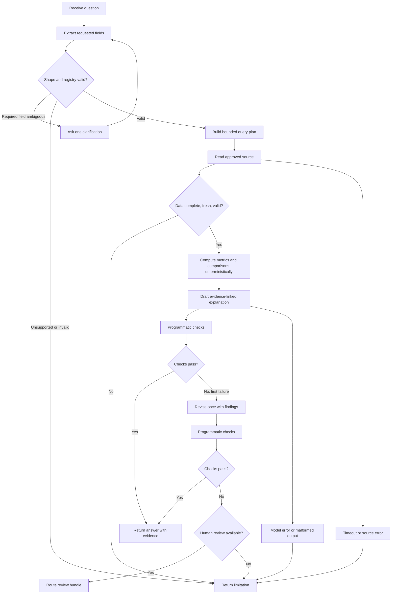

# Campaign Performance Analyst — architecture

## Design stance

Keep the first release as a small Go program with explicit orchestration in ordinary typed code. A framework adds lifecycle conventions and abstractions that are not yet needed for a short, fixed workflow. It may become useful if workflows become long-running, highly concurrent, or require durable scheduling and recovery. The initial interfaces should keep model and source adapters replaceable, but do not invent framework-specific APIs before those needs exist.

The repo currently has no implementation structure or build commands beyond a README. Package boundaries and exact commands remain open until implementation begins and the repository is inspected.

## Workflow graph

The diagram shows one clarification loop before retrieval and one answer revision maximum. No failure path loops without a bound.

## State passed between steps

Represent a run with typed, serializable fields. Exact Go types and storage format are implementation decisions.

- **Run metadata:** opaque run ID, start time, deadline, workflow version, status, current step, attempt counters.
- **Question:** original text, locale/time zone if provided, user/team scope, normalized metric ID, campaign ID, date range, comparison range, requested breakdown, confidence/ambiguity flags.
- **Definition:** approved metric ID and version, formula/components, units/currency, attribution window, aggregation and null rules, owner/source references.
- **Plan:** validated source ID, bounded dimensions/filters, date windows, row/point limit, required fields. It contains no arbitrary SQL or user-controlled expressions.
- **Evidence:** stable evidence ID, source and source account identifier (redacted as policy requires), query parameters, retrieval/as-of timestamps, definition version, dimensions, values, quality/freshness flags, and provenance.
- **Calculations:** deterministic inputs, formula version, outputs, deltas, and explicit unavailable/undefined reasons.
- **Draft/checks:** answer text, typed claims where practical, citation IDs, check findings, revision count, model metadata, final outcome and handoff bundle reference.

Pass each step only the context it needs. In particular, the drafting model receives the approved definition, sanitized question, calculated facts, and evidence snippets, not source credentials or unrestricted source payloads.

## Step responsibilities and boundaries

1. **Parse and validate.** Model-assisted extraction may map natural language into candidate fields. Deterministic code validates identifiers, ranges, allowed breakdowns, supported metrics, and completeness against the registry. Ask about a missing campaign, metric, or period before retrieval. Reject unsupported requests early.
2. **Plan.** Deterministic code converts validated fields into a small typed query request. Enforce date span, dimension allowlist, response-size, and per-run budgets.
3. **Retrieve.** A read-only interface exposes named operations such as resolving an approved campaign identifier and fetching approved metric inputs for a bounded window. It accepts structured parameters and returns typed rows plus provenance. The adapter owns source-specific translation. Do not expose general-purpose SQL, shell, filesystem, or write tools to the model.
4. **Validate data.** Deterministic checks reject malformed values, unexpected dimensions, duplicates where disallowed, missing required fields, stale data, and partial results unless the metric policy explicitly permits them. Distinguish zero from unknown/null.
5. **Compute.** Deterministic code calculates approved metrics, comparisons, percentage/absolute changes, and decompositions. Preserve units and rounding policy. A computed association is not a causal explanation.
6. **Draft.** A model turns facts into readable prose with references to evidence IDs. Require it to label observations and hypotheses and state uncertainty. It cannot call tools or change the computed facts.
7. **Check.** Deterministic checks verify output schema, numeric values against calculated facts, citation ID existence and coverage, allowed units/date windows, and mandatory caveats. A model-based reviewer can flag unsupported interpretations or missing context; its output is advisory and validated. Neither check proves that the upstream source or metric definition is correct.
8. **Return or route.** On first check failure, make one revision with structured findings, then re-run deterministic checks. On a second failure, source ambiguity, or unavailable reviewer, return a limitation or produce a review bundle. Only a real configured review destination should be called a routed review; otherwise show/save a review-ready bundle.

## Control flow, retries, timeouts, and stop conditions

- Use a total run deadline and smaller per-call timeouts for model and source operations. Values should be configurable and measured, not hard-coded into the product brief as promises.
- Retry only transient transport failures for a read operation, at most once with a short backoff and within the deadline. Do not retry invalid requests, permission failures, stale/partial data, or semantic model failures as if they were transient.
- Clarification is a user interaction, not a tool retry. Bound it to the fields needed to produce the current answer; if the user cannot clarify, stop without retrieval.
- Model calls have bounded input/output size and explicit token/cost limits. One malformed extraction or draft may be handled as a safe failure; answer revision is allowed once only after a failed check.
- Stop before retrieval for unsupported metrics, unresolvable entities, invalid date ranges, or missing required clarification. Stop after retrieval for permission errors, unacceptable freshness, incomplete data, or violated row/point bounds.
- Stop after the one revision if checks still fail. Never present a questionable answer as verified. Return a concise limitation with the failed check and available evidence, or request human review.

## Deterministic code versus model judgment

Use ordinary code for parsing dates into explicit ranges, registry lookup, permission and allowlist enforcement, query planning, bounded retrieval parameters, data-quality validation, arithmetic, rounding, deltas, citation resolution, schema checks, retries, budgets, and stop decisions.

Use a model only where flexible language understanding helps: mapping a question into candidate structured fields, asking a natural clarification question, and drafting readable prose from a small verified fact set. Model review can flag semantic problems but cannot establish numeric truth, source lineage, or causal validity. Treat all model output as untrusted input.

## Tracing, privacy, and audit

Emit one structured trace per run, with step spans. Include run ID, timestamps and duration, status, attempt number, workflow and metric-definition versions, source adapter/version, sanitized query shape, evidence IDs/count, data freshness, calculation inputs and outputs, model/provider/model-version, prompt-template version, token usage/cost when available, check names/results, clarification and revision counts, and final disposition.

Keep a separately access-controlled evidence bundle when the audit need requires it. Apply retention limits and deletion rules once the storage environment is selected. Redact credentials, direct identifiers, and unnecessary raw rows from general logs. Avoid logging full prompts or source payloads by default; when needed for debugging, use an approved redacted, access-controlled sample. Trace metadata is useful for investigation but does not itself verify the upstream data.

## Clarification and human-review resumption

For the initial CLI, clarification can pause the run in the process and continue after user input. Preserve the run ID and validated fields, re-run validation after the answer, and record what changed. If the process exits, restart from the original question; durable resumption is a later production feature.

A review bundle contains the original and normalized question, reason for review, metric-definition version, query and data provenance, calculations, draft/check findings, and unresolved questions. A human reviewer should be able to accept, edit, or decline the answer, and any response should retain that review outcome in the trace. The first release may print or save this bundle locally. Durable queues and resuming review across devices require a chosen storage/authentication design and are deferred.
